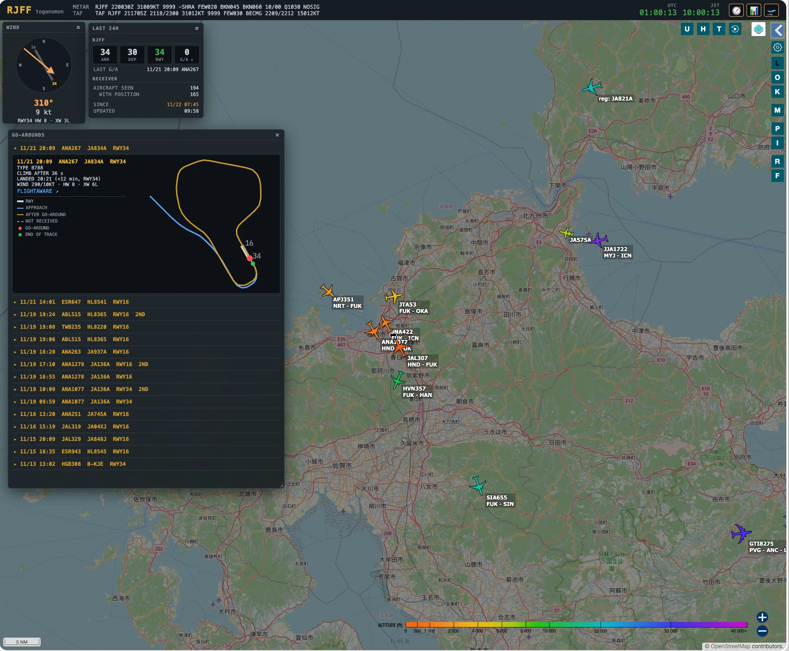

# toganomon

> **toganomon** — named after TOGA (Take-Off/Go-Around), the thrust setting
> a pilot selects to go around, plus *-nomon* for monitor.

Watches an airport from your ADS-B receiver: counts its arrivals and
departures, detects probable go-arounds and shows them in a browser over a
tar1090 map, with the METAR wind on the runways.



Status: extracted from a home receiver setup at Fukuoka (RJFF), where it has
run since November 2026.

Part of the same family as [gnomon](https://github.com/tanyorg/gnomon)
(GNSS/NMEA and PPS monitors) and [aisnomon](https://github.com/tanyorg/aisnomon)
(AIS reception monitor).

## What it does

- **Go-arounds.** An arrival through a runway gate (low, on the extended
  centreline, heading along the runway) followed by a departure of the same
  aircraft on the same runway within 10 minutes. A departure needs a real
  climb (200 ft within 30 s), so a gusty final does not fake one. An
  approach given up higher up counts too (a **missed approach**): down a
  final to 2000 ft or lower, then up 500 ft within 4 minutes, without an
  arrival. Each
  go-around is kept with the METAR wind and its head/cross components, what
  happened next (landed / went around again / did not land), the
  registration and type, and a thinned track.
- **The console**, one page with floating windows over the tar1090 map:
  - **RWY/WIND**: the runways where they are, the ones in use (arrivals
    blue, departures green), the METAR wind drifting across them, its
    gust, variable sector and the components on the runways in use. Each
    recorded movement is shown on its runway once, with its callsign; a
    go-around and a missed approach in amber.
  - **LAST 24H**: arrivals, departures, the runways in use (arrivals and
    departures apart where they use different ones), go-arounds, the
    last go-around when there was none in 24 hours, and the aircraft the
    receiver saw.
  - **GO-AROUNDS**: every go-around; each opens to a north-up track figure.
  - **MOVEMENTS**: the arrivals and departures of the last 24 hours with
    callsign, type and registration; a row shows that flight's track on
    the map, a G/A mark opens its go-around.
  - METAR and TAF in the header with the METAR's age (amber after 90
    minutes, red after 180) and an expired TAF marked; UTC and local
    clocks.
  - A chime when a new go-around appears (after the first click on the
    page, as browsers require; `?chime=0` turns it off).

It reads [readsb](https://github.com/wiedehopf/readsb)'s per-aircraft
traces; it does not decode radio itself.

## Quick start (Docker)

You need Docker with the compose plugin, and ADS-B data: either a receiver
that gives Beast output on TCP 30005 (readsb, dump1090-fa / PiAware, an
ultrafeeder you already run, ...) or an RTL-SDR on this host.

```sh
git clone https://github.com/tanyorg/toganomon.git
cd toganomon/docker
cp .env.example .env
vi .env                        # airport, receiver position, Beast source, port
docker compose up -d --build
```

Then open `http://<host>:8080/` (`WEB_PORT`).

> [!WARNING]
> **Do not expose the console to the internet.** It has no login, and the
> tar1090 map it includes shows **where your receiver is**: the site
> marker, range rings and every aircraft's distance from it, i.e. roughly
> where you live. Keep it on your LAN, or reach it over a VPN. Do not
> forward `WEB_PORT` on your router, and do not count on a host firewall
> (ufw, firewalld) to close it: Docker publishes ports through its own
> iptables rules, which bypass them.

This starts three containers:

| service | does |
|---|---|
| `ultrafeeder` | [docker-adsb-ultrafeeder](https://github.com/sdr-enthusiasts/docker-adsb-ultrafeeder): readsb + tar1090. Takes Beast from `BEAST_HOST:BEAST_PORT` and writes the traces toganomon reads |
| `toganomon` | built from this repository: detection every minute, METAR every 10 and TAF every 30 minutes from NOAA |
| `web` | nginx: the console at `/`, the JSON at `/toganomon/`, tar1090 at `/tar1090/` |

- **Already running a receiver?** Point `BEAST_HOST` at it. The bundled
  readsb only reads its Beast output; nothing changes on your receiver,
  and the stack feeds no aggregator.
- **RTL-SDR on this host?** Add the device settings from ultrafeeder's
  README to the `ultrafeeder` service (keep `READSB_EXTRA_ARGS` and the two
  volumes) and drop `ULTRAFEEDER_CONFIG`.
- **Proxmox LXC?** Docker runs in an unprivileged container with
  `features: nesting=1,keyctl=1` (tested on Debian 12).
- **The first 24 hours** count only what was received since the start; the
  LAST 24H window says SINCE when. To bring the go-around list of another
  installation along, see [docker/README.md](docker/README.md).

### Troubleshooting

- `docker compose logs ultrafeeder` on the first start shows
  `loading state ..... FAILED!` (there is no saved state yet) and may show
  `curl: (23) ...` from `tar1090-update` before it fetches the aircraft
  database another way. Both are harmless.
- The console stays empty: check that ultrafeeder reached your receiver
  (`docker compose logs ultrafeeder | grep "Connection established"`) and
  that `BEAST_HOST:BEAST_PORT` is a Beast output (usually 30005).
- No wind and no METAR in the header: NOAA has no reports for the ICAO,
  or the host cannot reach `tgftp.nws.noaa.gov`
  (`docker compose logs toganomon`).
- Arrivals stay at 0 while aircraft land: the airport's gate may not fit
  your reception; run the `--check-runways` command below.

## Using the console

- **Windows.** The buttons at the top right open and close them. Drag a
  window by its title bar; GO-AROUNDS and MOVEMENTS resize from the
  bottom-right corner. Which windows are open, and where, is remembered in
  the browser (localStorage).
- **MOVEMENTS** lists the last 24 hours, rolling (not since midnight), with
  a line for each day. A blue bar and badge mark an arrival (ARR), a green
  one a departure (DEP); the counts match LAST 24H. Click a row to see that
  flight on the map, centred on the airport:
  - **LIVE** while it is still on its way (up to 15 minutes after a
    departure, 3 after an arrival): the aircraft is selected on the live
    map and its track keeps growing.
  - **TRACE** afterwards: tar1090's history view of that part of the
    flight (15 minutes of approach before an arrival, 15 minutes of climb
    after a departure), loaded once.

  The line above the list says which flight is shown; **× LIVE MAP** (or
  the same row again) goes back to the live map. A **G/A** mark opens that
  go-around in GO-AROUNDS.
- **The map is tar1090.** toganomon only tells it which aircraft, day,
  time span and zoom to show; tar1090 draws the rest:
  - The track colour is the barometric altitude, as in the ALTITUDE bar at
    the bottom (orange near the ground, yellow and green through the
    climb, blue to magenta at cruise; grey on the ground). A thin, dark
    stretch is estimated: nothing was received there.
  - In a trace, times (UTC) label its two ends and where each flight
    starts and ends. The **K** button labels every point with altitude and
    time.
  - How far back a trace can go depends on ultrafeeder's globe history.

## Airport data

An airport in [`airports.json`](airports.json) needs only its ICAO code
(`TOGANOMON_ICAO`): the reference point, the elevation and the runway gates
come from there. It holds Fukuoka (RJFF), checked with a receiver there, and
Kansai (RJBB), Haneda (RJTT), Los Angeles (KLAX) and New York JFK (KJFK),
tuned on four days of adsb.lol traces each (not run live yet). More
airports are welcome as pull requests:

1. Draft the entry from [OurAirports](https://ourairports.com/data/)
   (public domain) with `tools/make_airports.py airports.csv runways.csv
   <ICAO>`. It takes the true track from the threshold positions and puts
   parallel runways less than 1 km apart into one gate.
2. Check it against real traffic: run `toganomon.py --check-runways` on a
   receiver that sees the airport's approaches (in Docker:
   `docker compose exec toganomon python3 /app/toganomon.py -c /var/lib/toganomon/toganomon.toml --check-runways`).
   It measures the passes through each gate (low, straight, along the
   runway) and prints the measured true track and centreline offset with
   OK or CHECK.
3. Put the result of the check in the entry's `checked`.

With recorded traces (a day of readsb's traces or globe history),
[`tools/tune/tune_airport.py`](tools/tune/README.md) replays them with
toganomon's detection and recommends the entry: track, centre and gate
width, with the arrivals, departures and go-arounds it then finds.
**It is experimental** (tried on RJFF, RJBB, RJTT, KLAX and KJFK only; it may change at any time):
check what it recommends by hand.

For an airport not in the file, write a configuration with its reference
point, elevation and runways as in [`examples/rjff.toml`](examples/rjff.toml)
and mount it at `/etc/toganomon.toml` (the commented line in
`docker/compose.yaml`).

## Configuration

`docker/.env`:

| key | meaning |
|---|---|
| `TOGANOMON_ICAO` | the airport, e.g. `RJFF` (must be in `airports.json`, or mount your own configuration) |
| `FEEDER_LAT`, `FEEDER_LON`, `FEEDER_ALT_M` | receiver position for readsb (decimal degrees, metres) |
| `FEEDER_TZ` | time zone of the containers, e.g. `Asia/Tokyo` |
| `BEAST_HOST`, `BEAST_PORT` | where ultrafeeder takes Beast from (port 30005 on most receivers) |
| `WEB_PORT` | port of the console on this host (8080) |

The console shows times in the browser's zone; add `?tz=Asia/Tokyo` to the
URL for another. Every key of the detection (gate sizes and altitudes,
go-around window, candidate radius, paths) is described in
[docs/INSTALL.md](docs/INSTALL.md); put them in your own `toganomon.toml`.

## Updating

```sh
cd toganomon && git pull
cd docker && docker compose pull --ignore-buildable && docker compose up -d --build
```

That follows `main`. To stay on a release instead, check out its tag
(`git checkout v0.1.0`, then the same `docker compose up -d --build`); the
[releases](https://github.com/tanyorg/toganomon/releases) say what changed.
Until 1.0, a new minor version (0.2.0) may change the detection or the JSON
output; a patch (0.1.1) only fixes bugs.

The go-around history and the state are on the `toganomon-state` volume and
survive updates. ultrafeeder is pinned to the build this was tested with
(`latest-build-993`): toganomon reads files inside it (the traces and
tar1090-db), so a newer build is tried before its tag is raised here. To
try one yourself, change its tag in `docker/compose.yaml`. nginx
(`stable-alpine`) and the worker's Python (`3.13-alpine`) follow their
fixes; `docker compose pull --ignore-buildable` (the worker is built here,
not pulled) fetches them.

## Without Docker

toganomon itself is one Python script (3.11 or later, standard library
only) run once a minute. To add it to a readsb you already run, without
Docker, follow [docs/INSTALL.md](docs/INSTALL.md): readsb needs
`--write-json-globe-index`, and the install uses cron and any web server.
The `web/` go-around view works there on its own; the full console expects
the Docker layout (`docker/nginx.conf`).

## Output

- `summary.json`: aircraft received in the last 24 h, arrivals, departures,
  the runways in use (the last half hour, arrivals and departures apart),
  go-arounds in the window.
- `go-arounds.json`: every go-around, newest first, with the airport and
  runway geometry for drawing the tracks. `done` turns true once the entry
  is settled: its outcome no longer changes (an arrival that looked like a
  landing can still become another go-around) and the track is complete.
  An `outcome` of `not_landed` carries `within_s`, the time waited for a
  landing (3600).
  A missed approach above the gate carries `missed`: `low_ft` (its lowest
  point above the airport) and `km` (how far before the runway's centre);
  its `arr_t` is that lowest point.
  `nth` is 2 (3, ...) when the same airframe with the same callsign went
  around within the previous 2 hours. `reg` and `type` (ICAO type
  designator) come from the tar1090 aircraft database; null when unknown.
- `movements.json`: the arrivals and departures of the last 24 h, newest
  first, with registration, type and the go-around each belongs to (the
  MOVEMENTS window).
- `movements.log`: one tab-separated line per arrival or departure: UTC
  time, `arr`/`dep`, runway, hex, callsign, ground speed (kt), emitter
  category. The long-term record of traffic, e.g. for go-arounds per 100
  arrivals.
- `events.log`: one line per go-around.

In Docker, the JSON is served at `/toganomon/` and the logs are on the
`toganomon-state` volume.

## Known limitations

- A go-around is an aircraft that came down low through the gate and then
  climbed, or one that came down a final to 2000 ft or lower and climbed
  500 ft again (a missed approach above the gate, e.g. TWB207 on 2026-11-19,
  7 km short of RJFF RWY16 at about 1000 ft). An approach given up higher
  than that, or off the extended centreline (a circling or curved
  approach), is not counted.
- What is not received cannot be judged. Where the ground and low altitudes
  are not received, a departure may first be seen already climbing (which
  is why the candidate altitude is well above the departure gate).
- A go-around is "probable": it is inferred from ADS-B alone, without ATC
  audio or any official source.

## Tests

```sh
python3 -m unittest discover -s tests
node tests/web_test.js
node tests/console_test.js
```

After changing a file in `console/` or `web/`, run `tools/stamp_console.py`:
it sets the `?v=` of that file in `console/index.html`, so browsers load it
again (the tests fail until it is run).

## License

MIT
